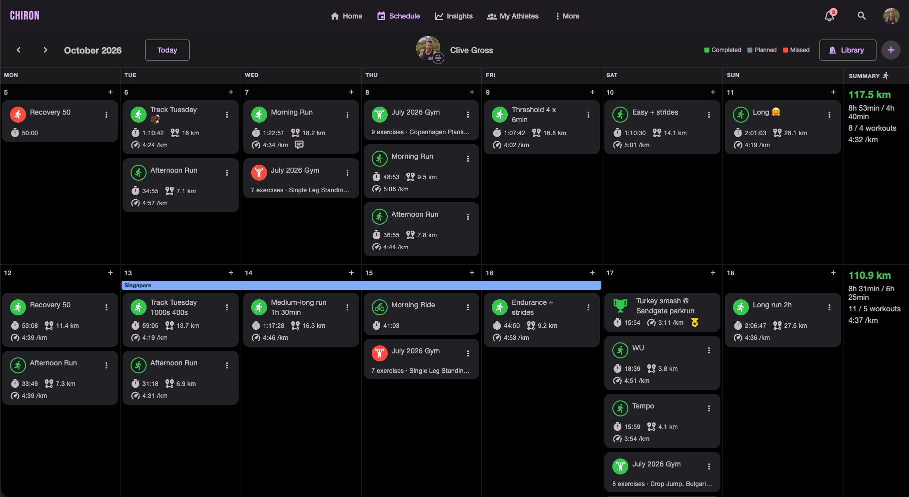
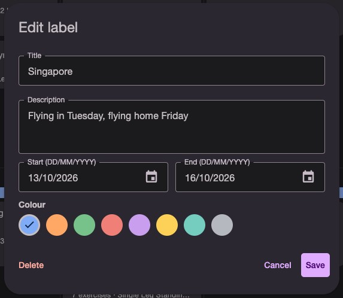
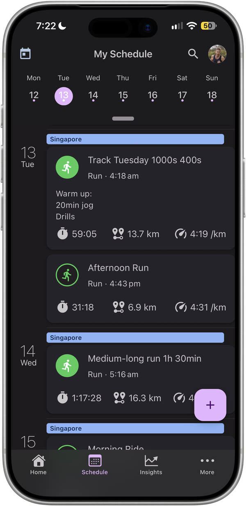

Training plans don't happen in a vacuum. An athlete flies out for a work trip on Tuesday and home on Friday. School holidays mean a week of runs squeezed in before the kids wake up. A calf niggle turns into five days of cross-training. A camp, a taper, a race week.

Most of the time the coach finds out in a text message or a quick chat at the track, and from then on it lives in someone's head. Three weeks later, looking back at a dip in volume, nobody remembers why.

Chiron now has **labels** to fix that.

## What a label is

A label is a coloured bar across one or more days on the schedule. Give it a title, an optional description, a start and end date, and one of eight colours. It sits on top of the training for those days, so the context is right there with the sessions.

Notes are still there for a thought about a single day. Labels are for a period of time.

## A better conversation between coach and athlete

Athletes and their coaches both see labels, and both can add, edit and remove them.

- **Athletes** can drop in a holiday, work trip or injury as soon as they know about it. The coach sees it the next time they open the schedule, before they plan the next block, not after the sessions have been missed.
- **Coaches** can mark out the shape of the plan: a base phase, a training camp, a taper, race week. The athlete can see where they are in the block without asking.

The description carries the detail that matters: flight times, what the physio has cleared, the race you're tapering for.

## Plan around life, not just around races

Labels earn their place when things don't go to plan.

- **Travel:** see the trip before you schedule a key session into it. Plan the long run for the day before the flight, keep the sessions on the road easy, and pick things back up when you're home.
- **Injury and illness:** when I fractured my fibula in March, every week of the return to run was its own phase. A label across each phase would have kept the whole picture on one screen. [CONFIRM: keep this personal example?]
- **Looking back:** when you review a training block months later, a lighter week explains itself.

On iPhone the label shows at the top of every day it covers, so it's there even on a rest day.

## How to add one

On the **Schedule** tab, tap **+** and choose **Label**, or tap **+** on a particular day to start from that date. Coaches can add labels the same way from any athlete's schedule.

The full walkthrough is in the Support Center: [Labelling Your Schedule](/support-center/schedule-labels/).

— Clive  
Founder, Chiron

**Plan your training around real life. [Sign up to Chiron →](/download/)**
