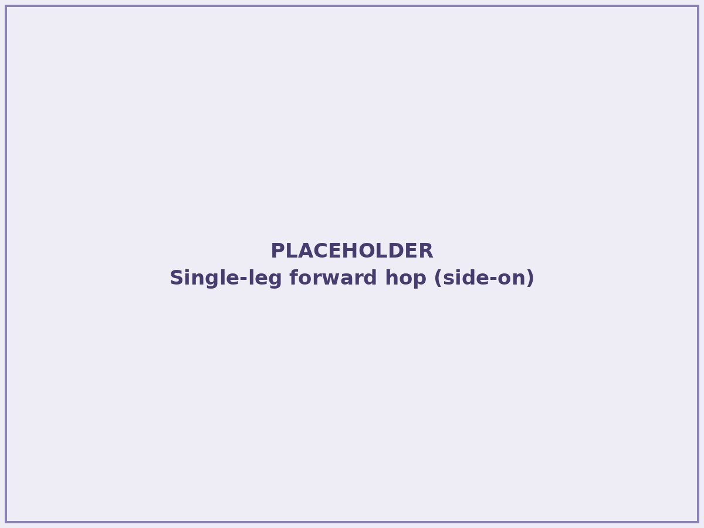
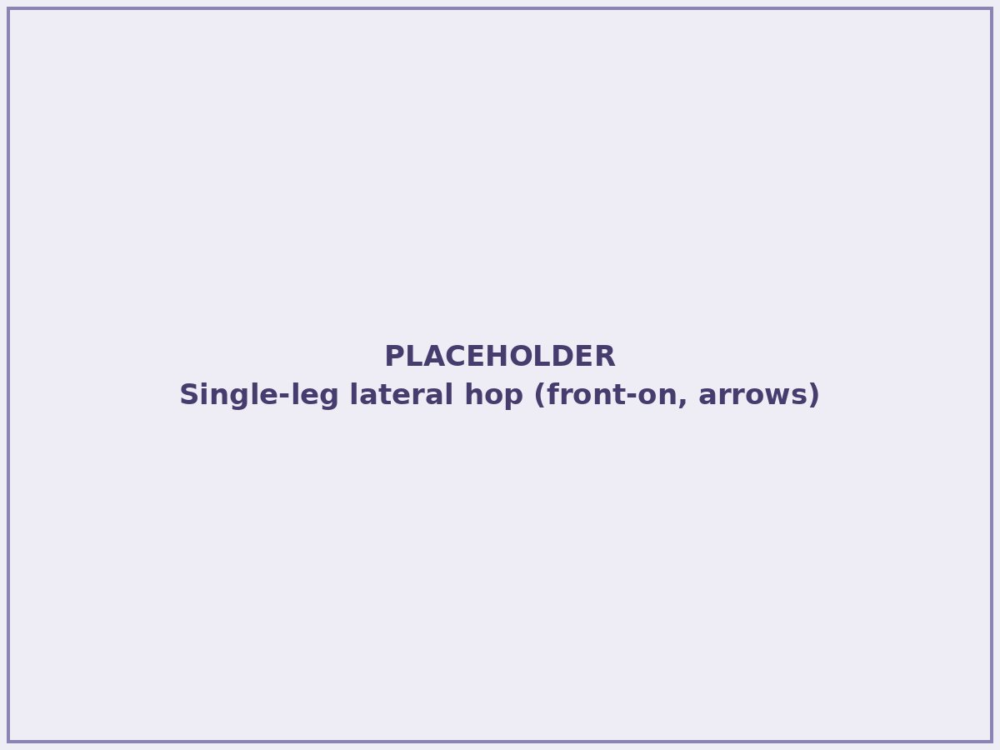
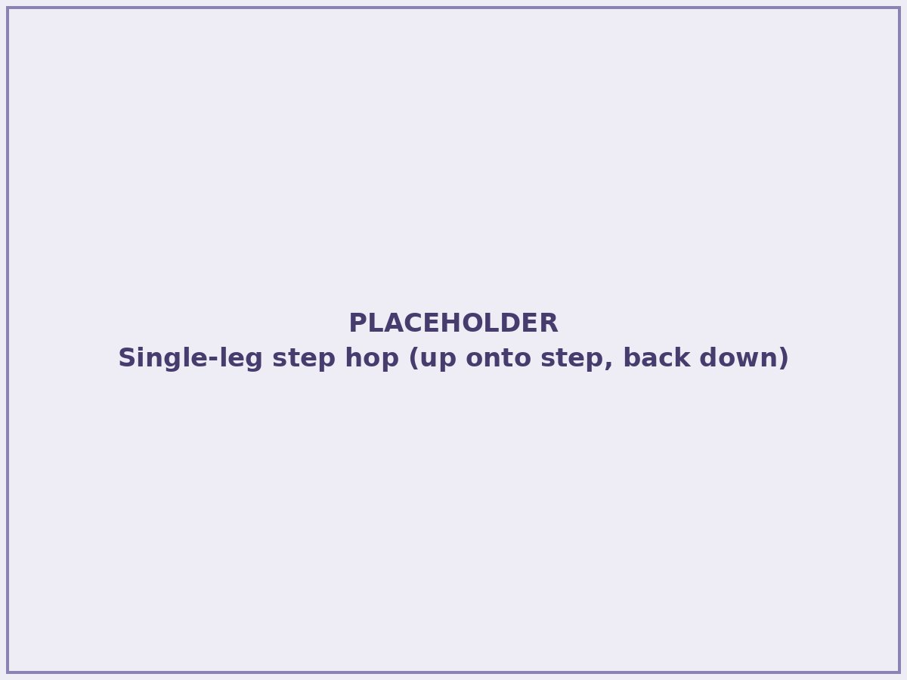

I'm staring down 40, and this year I've felt Father Time catching up with my body more than ever. Recovery takes a little longer. Niggles hang around a little more. The legs don't always snap the way they used to.

I've still run 2:27 for the marathon, and I can still run 2:38 for 1km. That second number is the one I'm fighting hardest to keep, because speed is the first thing age takes, and the thing that holds onto it is the short, explosive work most distance runners skip.

I've also had my share of bone injuries: a Weber A fibula fracture and two sacral bone stress injuries. So when I say plyometrics are non-negotiable for me, it's not because I read it somewhere. It's because I've seen what happens to a body that only ever does one thing.

This is my opinionated guide to plyos for distance runners: why they work, which ones are worth your time (and which aren't), and how to fit them into a week that's already full.

> **Before you start:** plyometrics are high-impact. Get advice from a running coach, strength coach or exercise physiotherapist before you start, especially if you're returning from injury, have existing joint issues, or haven't done any strength work before. This article is my experience and opinion, not individual advice.

## Why plyos are worth your time

### Springiness and running economy

Every running stride is a small jump. Your foot hits the ground, your tendons and muscles stretch, store energy, and release it to push you forward. The stiffer and more reactive that spring is, the less energy you spend producing each stride.

Plyometrics train exactly that: absorbing force and returning it fast. Better running economy means the same pace costs you less, and that shows up at every distance from the mile to the marathon.

One important nuance from the research: plyos on their own have only a small effect on running economy. Combined with resistance training, the effect is large — a 2023 meta-analysis found a trivial effect for plyometric jump training alone, but a large effect when it was paired with resistance training \[1\]. So plyos aren't a replacement for the gym. They're the other half of it.

### Performance

Better economy and more power translate to faster times, especially late in races when fatigue erodes your mechanics, like the last 10km of a marathon, when your stride starts to shorten and every step feels heavier. Plyos also keep your top-end speed alive, which matters for a surge in a pack or a sprint finish.

### Injury resilience

Plyos alone aren't an injury vaccine, but as part of a strength routine they make your tendons, muscles and bones better at handling load. And handling load is what running injuries are mostly about.

### Ageing: power goes first

As we age, we lose power faster than endurance. Fast-twitch fibres decline, ground contacts get longer, and stride gets shorter. Lots of masters runners can still run all day; they just can't run fast anymore. Plyos are the most direct way to keep training the qualities that fade first.

### Bone health

Bone responds to impact, especially high, fast, varied impact. Running gives you plenty of repetitive load in the same direction. Plyos add bigger forces, from different angles, in a handful of contacts. For anyone with a bone stress injury history (hello), or anyone over 35, that's a big deal.

## When to do them

Plyos are fast. Three sessions a week, under 12 minutes each, is enough, and I often get my dose done in under 6. That makes them one of the easiest things to fit into a busy life:

- **Before a weights session, as your warm-up.** Given the research above, this is the ideal pairing.

- **At morning tea at work.** You need a bit of floor, a step and some shoes.

- **At the opposite end of the day to your run.** This is my favourite, and here's why: bone becomes less responsive to loading after a bout of exercise and takes several hours to become responsive again — in animal loading studies, roughly eight hours of rest was enough to fully restore that sensitivity \[2\]. A short plyo session in the evening after a morning run gives your skeleton a genuine second dose, not just more of the same. It's an easy win.

- **As a run warm-up.** I often do a few sets of hops before a workout. It wakes up the legs and gets them ready to move fast.

What I'd avoid: tacking them on straight after a run when your legs are fatigued and your form is gone. Quality contacts are the point.

## How to get started: my four

Plyometrics are a sprinter's tool. Power is everything in a 100m, so that's where the payoff is biggest. Distance runners borrow them for a smaller return, but one that compounds over thousands of strides. That's exactly why we need to be choosy.

You'll find hundreds of plyometric exercises online, plus plenty of sprint drills that blur the line. I'm going to be opinionated here: don't waste time on plyos whose effect you could get by just running more.

That's why you won't see pogo hops on my list. Two-legged, low-amplitude pogos are good at teaching ankle stiffness, but their intensity isn't far off what running already gives you. If you're a distance runner, you're already doing thousands of those contacts a week. Plyos should give you something running can't.

### 1. Drop jumps (my favourite)

<figure>

<figcaption>

A drop jump, start to finish: step off, land, and spring straight back up. The goal is to spend as little time on the ground as possible.

</figcaption>

</figure>

Step off a low box, land on two feet, and spring straight back up as fast as you can, minimising your time on the ground.

Mechanically, this is the most bang for your buck for runners. Here's why.

When you land on the ground while running, your calf and Achilles work as a spring in what's called the stretch-shortening cycle. It happens in three steps:

1. **Pre-activation.** Before your foot touches down, your nervous system has already switched on your calf and quads, stiffening the leg in anticipation of the impact.

2. **Loading.** On contact, your body's momentum drives down into the ground. Your calf muscle fibres stay close to the same length, contracting almost isometrically, while the Achilles tendon does most of the stretching. The tendon is storing elastic energy, like a rubber band being pulled.

3. **Recoil.** The tendon snaps back and returns that energy, launching you into the next stride. The muscle mostly acts as a stiff anchor, so the tendon can do the work far more cheaply than the muscle could on its own.

That's why good runners look springy: much of each stride is powered by tendon recoil, not muscle contraction.

A drop jump trains this exact sequence, with more load. Dropping from a box raises the impact force beyond what running gives you, while the "get off the ground fast" cue keeps contact time short, as it is in running. Over time, your tendons get stiffer and better at storing and returning energy, and your nervous system gets better at pre-activating and stiffening the leg before landing. Bone gets a high-rate, high-magnitude loading signal too.

Put simply, it's running's stance phase, overloaded. Most other jumps either have too long a ground contact, like a big squat jump, or too little load, like a pogo, to train it this directly.

Start low: a 10cm drop, in shoes, on two legs. If even that is too much, especially if you're older, newer to strength work or have cranky knees, start with pogo hops as a stepping stone, then graduate to the drop as soon as you can.

### 2. Single-leg forward hops

<figure>

<figcaption>

Forward hops load one leg at a time — and quickly show you which side is doing less work.

</figcaption>

</figure>

Hop forward on one leg, landing and taking off quickly. Running is a single-leg sport, and this loads each side on its own. It also exposes asymmetries you didn't know you had.

### 3. Single-leg lateral hops

<figure>

<figcaption>

Hopping outward loads the groin and adductors on landing; hopping back inward loads the glute med and abductors.

</figcaption>

</figure>

The same idea, side to side. Running is almost entirely forward, so lateral loading is a gap that hops fill cheaply, and it gives your bones force from a direction they rarely see. It also works both sides of the hip. Hopping outward, away from your body, means your groin and adductors have to catch you on landing. Hopping back inward loads the outside of your hip, the glute med and abductors. Both are common weak spots in runners.

### 4. Single-leg step hops

<figure>

<figcaption>

A kerb, a step or a low slab is all you need. The step height caps the intensity for you.

</figcaption>

</figure>

Find a single step, kerb or low slab. Hop up onto it on one leg and straight back down, as quickly as you can, minimising ground contact on each landing. The step height naturally caps the intensity, and you can find one anywhere: home, the office, the park.

## My routine

If you're working with a running or strength coach, they're the best person to build plyos around you: your injury history, your goals and the rest of your training load. For what it's worth, here's what I'm doing at the moment.

Before a workout, I'll typically do 5 × 6 forward hops per leg and 5 × 6 lateral hops per leg. That's 60 contacts per leg, built up over years. Don't start there.

A few times a week, mid-morning or mid-afternoon, I leave my desk and do either 4 × 10 single-leg step hops per leg or 5 × 8 drop jumps. Either way it's 40 contacts per leg, done in a few minutes.

## Later: hurdle hops and loaded jumps

Once the basics feel easy, progress to bounding (exaggerated running strides, alternating legs, pushing for height and distance on every contact), hurdle hops (continuous hops over a row of low hurdles, on two feet or one) and countermovement jumps with weight. Bounding is the most running-specific of the lot: the same alternating rhythm as your stride, with more load on every landing. These are all more advanced and higher intensity, so earn them first.

## How much

Count ground contacts per leg, not minutes. A two-legged jump is one contact on each leg; a single-leg hop is one contact on that leg.

There's no single magic number, and the research on runners uses a wide range of programmes. But a sensible guide looks like this:

- **Getting started:** around 30–60 contacts per session, 2 sessions a week, using the lowest-intensity versions (two-legged, small drop, low step).

- **Progressing:** build toward 60–100 contacts per session over a couple of months, then add a third session.

- **Experienced:** 100+ contacts, higher intensities, once you've built a base over many months.

- **Single-leg contacts are harder.** Each leg is taking your full body weight, so progress to single-leg work after you're comfortable on two.

- **Quality over quantity.** If your contacts start getting slow and heavy, the set's over.

The same rule as running applies: too much too soon is how you get hurt. And the one I see people break most often: don't build plyo load at the same time as you're building running load. Pick one. If you're ramping into a marathon block, hold your plyos steady. Build them in a base phase or a quieter month, then maintain them.

## Be patient

You probably won't notice anything in two weeks. You might not notice much in four. The studies showing the biggest gains in running economy ran for more than seven weeks, at more than two sessions a week, and totalled more than fifteen sessions \[1\].

But if you've stuck with distance running long enough to be reading an article about plyometrics, you already understand patience and consistency better than most people. Give it three months: three short sessions a week, contacts building slowly. Then go and run a fast kilometre and see how your legs feel.

## How I make sure they actually happen

<figure>

<figcaption>

Plyos scheduled in Chiron alongside the week's running, so they get ticked off like any other session.

</figcaption>

</figure>

The hardest part of plyos isn't the plyos. It's remembering to do them. So I schedule mine every week in Chiron alongside my running, the same as any other session, and tick them off when they're done. They never get forgotten.

If you see me pop out of my office mid-morning to hop on and off the slab by the entrance, now you know why.

---

**Want to plan your plyos alongside your running? [Download Chiron](/download/) and build the whole week in one place.**

## References

\[1\] Dudagoitia Barrio E, Fernández-Landa J, Negra Y, Ramirez-Campillo R, García de Alcaraz A. Effects of plyometric jump training on running economy in endurance runners: a systematic review and meta-analysis. Kinesiology. 2023;55(2):270–281. Available from: [https://doi.org/10.26582/k.55.2.11](https://doi.org/10.26582/k.55.2.11)

\[2\] Robling AG, Burr DB, Turner CH. Recovery periods restore mechanosensitivity to dynamically loaded bone. J Exp Biol. 2001;204(19):3389–3399. Available from: [https://doi.org/10.1242/jeb.204.19.3389](https://doi.org/10.1242/jeb.204.19.3389)
